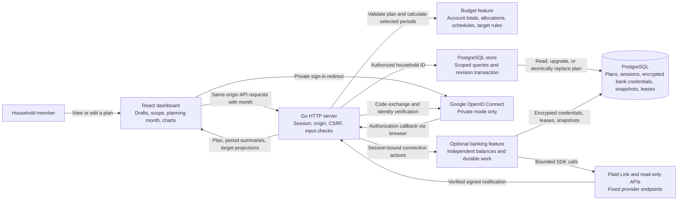
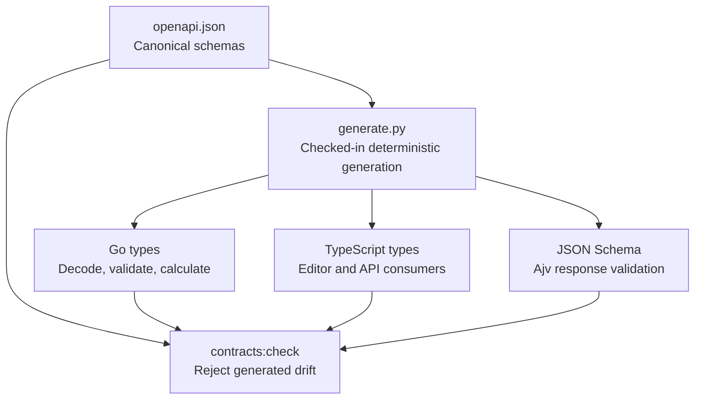

# System design

Bank Piggy turns one saved household plan into consistent household and personal views. Go owns permissions, validation, financial rules, and persistence. The browser owns drafts, navigation, and presentation.

These documents describe the implemented first version. Update the diagrams when routes, state ownership, or transaction boundaries change. The [product brief](../product-brief.md) includes future work that is outside this implementation.

See [read-only Plaid connections](plaid.md) for account linking, balance projection, durable synchronization, encryption, reconnect, and disconnect.

See [household sharing, payroll, and pay-period tasks](sharing-payroll-todos.md) for invitation claims, contribution estimates, expected dates, reminder allocation, and completion transactions.

See Overview on [desktop](images/overview.png) or [mobile](images/mobile.png), Money flow on [desktop](images/money-flow.png) or [mobile](images/mobile-money-flow.png), Expenses on [desktop](images/expenses.png) or [mobile](images/mobile-expenses.png), and Goals on [desktop](images/goals.png) or [mobile](images/mobile-goals.png). The previews use fictional local reference data.

## Architecture



There is one Go process and one PostgreSQL database. The built Go process can serve the frontend and API from the same origin. During development, Vite serves the frontend and proxies API and sign-in paths to Go. An optional Plaid worker runs inside this process. PostgreSQL stores its due times, leases, encrypted credentials, and independent snapshots. No external queue or cache service is required. See [read-only Plaid connections](plaid.md) for its trust boundaries and sequence diagrams.

Before the listener starts, [Store.Open](../../apps/api/internal/store/store.go) applies schema creation and the account upgrade in one transaction. A failed upgrade stops startup. See the [account upgrade](data-model.md#account-upgrade) for preservation and revision rules.

### Ownership

| Component                                                           | Owns                                                                                  | Does not own                                                             |
| ------------------------------------------------------------------- | ------------------------------------------------------------------------------------- | ------------------------------------------------------------------------ |
| [React workspace](../../apps/web/src/Workspace.tsx)                 | Selected view, household/member scope, period, active editor.                         | Financial allocation rules or household authorization.                   |
| [Session and persistence hooks](../../apps/web/src/useBankPiggy.ts) | Loaded server state, request generations, save feedback, draft-safe failure handling. | Durable plan storage.                                                    |
| [Browser API boundary](../../apps/web/src/api.ts)                   | Same-origin requests and runtime validation of successful responses.                  | Trust in arbitrary JSON because it has a TypeScript type.                |
| [Go server](../../apps/api/internal/server/server.go)               | Routing, sessions, request checks, and orchestration.                                 | UI draft state.                                                          |
| [Budget feature](../../apps/api/internal/budget/calculate.go)       | Pure financial calculations from a validated plan.                                    | SQL, HTTP, or provider calls.                                            |
| [Store](../../apps/api/internal/store/store.go)                     | PostgreSQL queries, identity binding, session lookup, and atomic revision changes.    | Client-selected household identity.                                      |
| [OpenAPI contract](../../packages/contracts/openapi.json)           | Canonical request and response shapes.                                                | Cross-record business rules, such as valid owners or safe salary splits. |

## Focused workspace

Overview is the default and renders [HouseholdOverview](../../apps/web/src/components/HouseholdOverview.tsx): Plan totals, At a glance, and Balances. [At a glance](../../apps/web/src/components/PlanDetails.tsx) shows the saved members in compact income and balance tables. New plans start with one person; setup can append an optional second profile. Large display values keep their exact amounts in accessible labels and hover text. Balances shows scoped account-type breakdowns; plan setup manages individual account records. Money flow renders the Sankey. Expenses combines every payment type. Goals selects ordinary contributions with optional saved progress; Trips & purchases selects dated trip and purchase goals. These views share one saved plan.

Planning views keep scope, period, and planning month above the active view. To-do keeps scope and uses its own As-of date. Accounts shows all linked provider snapshots, including returned credit and loan accounts, with update times and no planning multipliers. It uses the shared connection request owner and never calculates new asset/debt totals in the browser. [Record selectors](../../apps/web/src/features/plan/viewRecords.ts) preserve ownership and leave the plan unchanged. Expenses filters All types, Subscriptions, Bills & costs, or Loans, then sorts the selected scope and period's canonical allocations from largest to smallest. Ties retain saved order. Upcoming, ended, and zero-share records remain reachable. The card's add actions inherit its filter; All types and the header's Add expense default to a bill. The [view registry](../../apps/web/src/features/plan/views.ts) owns the seven navigation labels and header actions.

The frame uses `100dvh`, the browser's dynamic viewport height. The document, `.main`, and `.view` remain still. [FinanceCard](../../apps/web/src/components/FinanceCard.tsx) allocates one scrollable body below fixed headers, actions, and optional filters, with an optional fixed footer. Each body is a named region with keyboard focus. The Money flow chart uses the same boundary through the `flowBody` region in [Dashboard](../../apps/web/src/components/Dashboard.tsx). See [workspace layout](../../apps/web/src/Workspace.module.css) and [card layout](../../apps/web/src/components/FinanceCard.module.css).

[Modal](../../apps/web/src/components/Modal.tsx) keeps its heading and close action fixed. Its inset, named body owns form scrolling and leaves room for visible field focus rings. Thin taupe scrollbars use transparent tracks and remain inside the rounded surface.

[HouseholdOverview](../../apps/web/src/components/HouseholdOverview.tsx) gives Plan totals, At a glance, and Balances bounded desktop sections. Narrow or short layouts show one section chosen through three native buttons with `aria-pressed`. Compact tables keep the core comparison together; long balance breakdowns scroll within their card.

Account balances, planned contributions, and manually recorded goal progress have separate owners and meanings. Go derives savings and investment summaries from member-owned account records. Goal rows use [progress presentation](../../apps/web/src/features/plan/goalProgress.ts) only when a target exists: saved amount of target and a bounded native bar, with the contribution shown separately. Untargeted rows show the contribution alone. Payment icon colors follow the saved payment kind, so sorting and filtering preserve their meaning.

The Money flow chart measures its actual height with `ResizeObserver`. It reserves rows for goals and money left to plan, then keeps the largest expense categories that fit. Remaining categories combine into `Other costs (N)`. [Category grouping](../../apps/web/src/components/moneyFlowCategories.ts) adds exact cents and leaves the saved records unchanged. Full detail stays in Expenses.

[MoneyFlow](../../apps/web/src/components/MoneyFlow.tsx) owns one renderer and observer for each visible chart element. Data, period, and scope changes merge into the series under a stable ID. Resize callbacks use the latest committed inputs and ignore disposed or superseded renderers. Empty transitions and unmount release the observer and renderer. Setup or rendering failure also releases resources while preserving the original error. The yearly response view is memoized to avoid redundant chart updates during unrelated UI changes.

## Read and edit flow

The browser first asks for its session. It reads household data only after the server confirms authentication. A household response contains the complete saved plan, the accepted planning month, monthly and 12-month summaries, and separate trip and purchase projection arrays. The frontend uses the server's expense shares.

The optional `month=YYYY-MM` query selects the projection month on both reads and saves. The server defaults to the current UTC month and accepts `0001-01` through `9998-12`. The browser keeps the accepted month in its URL and reuses it for saves and reloads. Changing the field applies a valid projection automatically without changing the plan revision.

The selector remains enabled during reads. Its asynchronous callback reports whether the latest selection loaded. A failed latest read restores the accepted value only if that selection is still current. Request generations keep later choices authoritative, including a return to the accepted month. See [planning control](../../apps/web/src/components/PlanningMonth.tsx) and [read ownership](../../apps/web/src/features/session/use-loaded-state.ts).

[MonthPicker](../../apps/web/src/components/MonthPicker.tsx) reuses a themed native popover for planning, payment start and end dates, and target deadlines. Its calendar keeps year edits local until a month is chosen, disables out-of-range months, and supports arrows, Home, End, and touch. Optional fields expose Clear month. Form-owned validation enforces required values. The [popover controller](../../apps/web/src/components/useMonthPopover.ts) positions the panel within the visual viewport and returns focus after selection.

```mermaid
sequenceDiagram
    actor Member
    participant UI as React editor
    participant API as Go HTTP server
    participant Budget as Budget feature
    participant DB as PostgreSQL

    Member->>UI: Edit a local draft
    Member->>UI: Save plan at revision N
    UI->>API: PUT /api/household?month=YYYY-MM + session cookie + CSRF token
    API->>DB: Look up session and household membership
    API->>API: Check exact Origin and CSRF token
    API->>Budget: Validate complete plan
    API->>DB: BEGIN; SELECT revision FOR UPDATE
    alt Submitted revision equals saved revision
        API->>DB: Replace plan; increment revision; COMMIT
        API->>Budget: Calculate period summaries and target projections
        API-->>UI: 200 plan and projections at revision N+1
        UI-->>Member: Show accepted plan and close editor
    else Another save changed the revision
        API->>DB: ROLLBACK
        API-->>UI: 409 revision_conflict
        UI-->>Member: Keep draft and show reload instruction
    end
```

One browser serializes its own writes. PostgreSQL serializes writes from different browsers by locking the household row. Both controls are necessary: a local busy flag cannot protect against another signed-in member.

Editors keep money as text until validation creates integer cents. Fields and closing controls are disabled during a save. A failed save keeps the editor and draft. A revision conflict requires an explicit reload before further writes. A successful reload clears the conflict; it does not merge competing drafts.

Read generations ignore results from older requests or an unmounted component. Save results must still belong to the current session and must not replace a newer loaded revision. These checks keep a late response from restoring stale data.

## API surface

| Route                                    | Access and result                                                                                                  |
| ---------------------------------------- | ------------------------------------------------------------------------------------------------------------------ |
| `GET /healthz`                           | Database health check; `503` when PostgreSQL is unavailable.                                                       |
| `GET /api/session`                       | Current session metadata, or an unauthenticated response.                                                          |
| `POST /api/demo/session`                 | Exact-origin, loopback-only local session. New plans start empty.                                                  |
| `GET /api/household?month=YYYY-MM`       | Valid session and supported month; saved plan, period summaries, and trip and purchase projections.                |
| `PUT /api/household?month=YYYY-MM`       | Valid session, exact origin, CSRF token, valid plan, and current revision; returns projections for the same month. |
| `POST /api/logout`                       | Same mutation checks; revoke session and clear cookie.                                                             |
| `GET /api/household/invitation`          | Current member; link state without the secret.                                                                     |
| `POST /api/household/invitation`         | First member, origin, CSRF, and an unlinked partner slot; create or replace a link.                                |
| `DELETE /api/household/invitation`       | First member, origin, and CSRF; revoke a pending link.                                                             |
| `POST /api/household/invitation/prepare` | Exact-origin JSON request; limited preview and short-lived invitation cookie.                                      |
| `GET /api/todos?date=YYYY-MM-DD`         | Current member and explicit calendar date; generated tasks with persisted completion.                              |
| `PUT /api/todos/{id}`                    | Current member, origin, CSRF, plan revision, validated source task, and expected checkbox state.                   |
| `GET /auth/google`                       | Start Google sign-in in configured private mode.                                                                   |
| `GET /auth/google/callback`              | Consume a sign-in attempt, verify Google identity, bind invitation, issue session.                                 |
| Other `GET` application paths            | Built frontend or a safe missing-frontend response. Unknown API/sign-in paths return `404`.                        |

The client receives safe error codes and messages. Request failures do not return database errors or financial payloads in logs. See [security](security.md) for the exact checks and the limits of this boundary.

## Contract flow



The generator supports the schema features used by this contract. It is a small project tool, not a general OpenAPI generator. Go also enforces required JSON fields, rejects unknown fields, and applies domain validation. Ajv checks successful browser responses at runtime. Static TypeScript checks alone would not validate a network response.

## Verification boundary

The latest optional bank-balance work has a separate [Plaid verification record](plaid-verification.md). It includes PostgreSQL 18 checks, independent reviews, and explicit provider and deployment limits. The earlier manual-planner evidence below keeps its original scope.

The installed quality hook passed contract and provider drift checks, formatting, 159 authored files within size limits, strict lint with zero issues, types, unused checks, 44 Node regressions, Go race tests with real PostgreSQL, and both builds. The local database is PostgreSQL 14.15. GitHub checks also passed for the [API layer](https://github.com/MichaelGorman2004/Bank-Piggy/actions/runs/43041241482) and [dashboard layer](https://github.com/MichaelGorman2004/Bank-Piggy/actions/runs/43043309580) using PostgreSQL 17 and Node.js 24.

The repository checks cover these contracts:

| Check                                                                                                                                                                                                     | Covered behavior                                                                                                                             |
| --------------------------------------------------------------------------------------------------------------------------------------------------------------------------------------------------------- | -------------------------------------------------------------------------------------------------------------------------------------------- |
| [PostgreSQL store tests](../../apps/api/internal/store/store_test.go) and [HTTP tests](../../apps/api/internal/server/purchases_test.go)                                                                  | Saved revisions, competing writes, session expiry, identity binding, and complete schedule/target JSON round-trips.                          |
| [Startup tests](../../apps/api/internal/server/startup_test.go)                                                                                                                                           | Empty local startup and complete preservation of saved local and private plans across repeated startup.                                      |
| [Budget tests](../../apps/api/internal/budget/calculate_test.go), [schedule tests](../../apps/api/internal/budget/schedule_test.go), and [target tests](../../apps/api/internal/budget/purchases_test.go) | Exact cents, inclusive payment dates, repeated monthly shares, target periods, and separation from balances.                                 |
| [Signed local identity provider](../../apps/api/internal/server/google_token_test.go)                                                                                                                     | Signature, audience, issuer, expiry, nonce, verified email, and subject checks. This simulates Google.                                       |
| [Selector tests](../../apps/web/src/features/plan/viewRecords.test.mjs) and [category tests](../../apps/web/src/components/moneyFlowCategories.test.mjs)                                                  | Canonical expense sorting, type filtering, ownership, stable ties, and cent-preserving chart grouping.                                       |
| [Account tests](../../apps/api/internal/budget/accounts_test.go) and [migration tests](../../apps/api/internal/store/accounts_migration_test.go)                                                          | All eight types, group bounds, preserved legacy totals, typed-account precedence, idempotence, revision conflicts, and atomic rollback.      |
| [Saved-progress HTTP tests](../../apps/api/internal/server/savings_targets_test.go) and [UI tests](../../apps/web/src/features/plan/savingsTargets.test.mjs)                                              | Complete progress fields, mutually exclusive target kinds, whole-cent preservation, overfunded bars, and unchanged allocations and balances. |

Local browser checks covered populated plans, keyboard focus, card-body scrolling, mobile and short layouts, and editor reachability. Empty, sparse, and error states used browser-only simulations. A simulated `503` retained drafts; a real competing PostgreSQL update returned `409` and recovered through explicit reload. Temporary test records were removed.

Meaningful financial cases included a $10.01 expense with a 0% share retained through save and reopen, a 36-payment loan stopping after its inclusive final month, and a $2,000.01 purchase target with $500 saved across four periods suggesting $375.01 per month. Choosing a $125.50 contribution affected that allocation alone; recorded savings stayed unchanged.

Controlled chart checks retained one SVG element across period, scope, editor, response, and resize changes. Fixtures also checked removed nodes, empty transitions, stale observer callbacks, and failure cleanup. Calendar checks covered automatic application, failed-request recovery, newer choices winning over held responses, and returning to the accepted month while an older successful request remained pending. Keyboard navigation, Escape, light dismiss, focus return, optional clearing, required validation, payment terms, and retained target drafts passed.

An earlier browser pass checked the original five financial views at 320×568, 390×844, 844×390, 1366×768, and 1512×857. At a glance shows both tables, twelve values, and the shared split without internal scrolling. Account insertion, removal, exact-cent saves, reopen, simulated `503` recovery, and keyboard focus passed. Ordinary goal create/edit/reopen, saved/target drafts, zero-target rejection, overfunded progress, and failed-save retry passed. These tests restored the isolated reference records and totals after writes. The compiled preview additionally passed empty/error retry and phone containment checks without financial writes or browser errors.

That earlier browser review used the compiled Go app at `http://127.0.0.1:5173`, serving the API and static frontend without Vite hot module replacement. The native context uses `viewport: null`; all five views fit its measured 1512×857 window after reload. Health returned `200`, and no Vite client or browser errors were present. Human review of the compiled preview reported “No blink now.” The earlier idle blink was not reproduced in headless checks, and its cause remains unproven.

Populated application browser evidence uses isolated local reference data. Private Railway deployment, HTTPS, PostgreSQL health, one invited Google sign-in, and saved-name persistence through restart and redeployment have also passed. Native Safari review covered the deployed interface. The second invited login, live rejection of an uninvited account, physical iOS, connected banks, and backup restore remain unverified. CI evidence is separate from live service checks.

## Browser verification procedure

1. Isolate emulated viewport and device profiles in separate browser contexts.
2. Use the actual window with `viewport: null` and the compiled Go app for handoff. Reload and check measured frame bounds before screenshots.
3. Test all seven views, linked account rows and freshness, typed-account edits and grouped totals, targeted and untargeted goal rows, compact At a glance tables, expense filters, named card-body scrolling, calendar bounds, keyboard focus, and short-screen placement.

Continue with the [data model](data-model.md), [security model](security.md), [design decisions](decisions.md), or [user stories](../user-stories.md).
