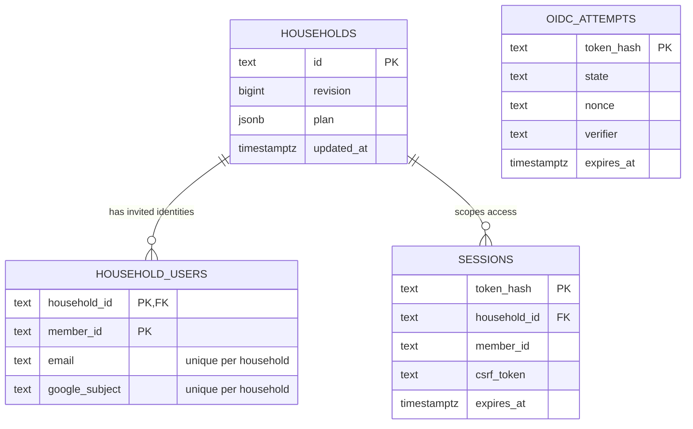
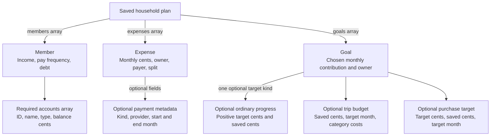

# Data model and financial rules

PostgreSQL stores one current plan per household. Go derives the totals on each read and accepted save. The database does not store a second copy of calculated summaries.

## Durable model



The SQL schema is in [schema.sql](../../apps/api/internal/store/schema.sql). Plan members are embedded in JSON, so `sessions.member_id` is an application-checked identifier rather than a foreign key to a member table. Sign-in attempts are independent, short-lived records; they do not require an authenticated user.

The application currently chooses one fixed household ID per mode: `demo-household` or `private-household`. This supports one private two-person household, not general household creation or tenant administration. Initial seeding uses `ON CONFLICT DO NOTHING`, so restarting the server preserves saved plans.

The interface uses the saved member names and household labels in both modes. That display choice does not alter the seeded reference data, household IDs, or server authorization.

### Plan document

| Record    | Main fields and meaning                                                                        |
| --------- | ---------------------------------------------------------------------------------------------- |
| Household | Revision, two ordered members, expenses, goals, default expense split method.                  |
| Member    | Fixed ID, name, salary, monthly take-home pay, debt, pay frequency, required accounts array.   |
| Expense   | Stable ID, name, category, monthly cents, owner, payer, saved split method, custom percentage. |
| Goal      | Stable ID, name, monthly contribution in cents, personal or shared owner.                      |

Expenses also accept optional payment metadata: `kind` (`subscription`, `bill`, or `loan`), `providerId`, `startMonth`, and `endMonth`. A goal can contain one of `savingsTarget`, `trip`, or `purchase`, or none. Go rejects combinations. Accounts and target details stay inside the existing JSONB plan; no separate account, payment, or target table is needed.



The plan revision appears in both the row and JSON document. The store advances and saves them together. The API accepts a complete replacement document, so each editor starts from the last accepted revision and changes only its owned fields.

JSONB keeps the small plan as one atomic unit. The current product reads and edits that whole unit. Normalized identity and session tables provide relational uniqueness and expiry queries where they are useful. Transaction history, per-record audit history, and historical plan snapshots are not present.

## Manual accounts

`Member.accounts` is required and can be empty. Each `AccountBalance` has a stable ID, name, canonical type, and nonnegative `balanceCents`. IDs are unique within that member; the same ID can exist under the other member. The API accepts at most 20 accounts per member.

| Derived group | Account types                                                                            |
| ------------- | ---------------------------------------------------------------------------------------- |
| Savings       | Savings, High-yield savings.                                                             |
| Investments   | Traditional 401(k), Roth 401(k), Traditional IRA, Roth IRA, Brokerage, Other investment. |

Every account and each member's savings and investment group must fit `MaxMoneyCents`. Go derives the `Summary` totals from account records. `Member` no longer stores duplicate `savingsCents` or `investmentsCents` fields. Debt remains a separate manual member balance. The household adds member snapshots once, and yearly views leave them unchanged.

The frontend uses the generated account types for labels, draft conversion, and scoped breakdowns. Saved amounts stay as editable text until validation produces cents. Account names, types, IDs, and order survive normal plan saves. See [backend account rules](../../apps/api/internal/budget/accounts.go) and [frontend account helpers](../../apps/web/src/features/accounts/accountTypes.ts).

### Account upgrade

[Startup migration](../../apps/api/internal/store/migrations.go) creates the schema and upgrades legacy plan JSON in one PostgreSQL transaction. The [embedded SQL](../../apps/api/internal/store/accounts_migration.sql) locks affected households, converts old savings and investment aggregates to generic Savings and Other investments accounts, and removes the old aggregate keys. It preserves existing typed account arrays and member order. It does not infer a retirement or Roth classification from an old total.

Each affected household advances both its row revision and JSON revision once. Reopening an already canonical plan makes no further change. A canonical write using a pre-upgrade revision receives `409`; removed aggregate fields also fail input validation. A migration failure rolls back the transaction and closes the failed pool; it cannot leave another matched plan partly upgraded. [Real PostgreSQL migration tests](../../apps/api/internal/store/accounts_migration_test.go) cover legacy, mixed, already typed, repeated, stale-revision, and rollback cases.

## Money and allocation invariants

All stored and calculated money uses integer cents. A decimal input such as `19.99` becomes `1999`; extra fractional digits are rejected. An entered zero is different from an omitted required field. Go validates required fields before decoding can turn a missing value into zero.

The server requires exactly two ordered members, `member-1` and `member-2`. Each amount must be nonnegative and at most `100,000,000,000` cents. Plans allow at most 100 expenses and 30 goals. IDs must be valid and unique within their record type. Owners and payers must refer to the known members or the permitted shared/empty value.

For every expense included in the selected month:

```text
first member's cents + second member's cents = expense's cents
```

| Split          | First member's share                                                               | Second member's share |
| -------------- | ---------------------------------------------------------------------------------- | --------------------- |
| Personal owner | Full amount for member 1, otherwise zero.                                          | The remainder.        |
| Equal          | Half, rounded up on an odd cent.                                                   | The remainder.        |
| Custom         | Amount × first member's basis points ÷ 10,000, rounded to cents.                   | The remainder.        |
| Salary         | Amount × first annual base salary ÷ combined annual base salary, rounded to cents. | The remainder.        |

A basis point is one hundredth of a percent. The custom share ranges from 0 to 10,000 basis points, including explicit 0% and 100%. Proportional shares round to the nearest cent; half-cent ties go to member 1. `math/big` prevents overflow in the intermediate multiplication. The second share is subtraction, not a separately rounded result.

For example, an equal split of $1.01 is $0.51 and $0.50. With salaries of $100,000 and $50,000, a $3,000 shared bill is $2,000 and $1,000. The household shows $3,000 once. Both zero salaries reject a shared salary split; one zero salary and a positive combined salary are valid.

`paidByMemberId` records who paid. It does not change ownership or allocation. The default split method initializes new expenses. Each expense retains its own method and custom percentage. Salary-based shares use the current plan's salaries, so editing salary recalculates the current plan. This version does not preserve historical allocation snapshots.

Shared goals use an equal split, including the same odd-cent rule. Personal goals belong entirely to their owner. Goals do not inherit the expense split method.

Source: [validation](../../apps/api/internal/budget/validate.go), [calculations](../../apps/api/internal/budget/calculate.go), and [boundary tests](../../apps/api/internal/server/split_roundtrip_test.go).

## Plan totals

For each member, Go calculates:

```text
available for goals = monthly take-home pay − allocated living expenses
left to plan       = available for goals − allocated goal contributions
```

The household totals add both members' results. This counts each shared expense or goal once because its personal shares already reconcile. Minimum debt payments belong in expenses. Extra debt payments can be goals. Savings, investment, and debt balances are separate snapshots and do not change cash flow.

The Sankey uses these same summary values and allocated expense shares. When available height limits category rows, the chart combines smaller expense categories into `Other costs (N)` without changing their sum. When allocations exceed income, it adds a labeled **Plan shortfall** source so the graph remains balanced. That source represents a funding gap, not new income or an inferred loan.

## Scheduled payments and projection months

A payment is active when the selected month is on or after its optional start and on or before its optional end. Both boundaries are inclusive. An undated existing expense remains active in every month. Upcoming and ended records remain saved and editable in the expense management view. Their selected-month shares are zero, so they do not affect its totals or Sankey.

The editor supports an ongoing payment, a final month, or 1–1,200 monthly payments from a required first month. It converts a finite term into one canonical `endMonth`. For example, 36 payments starting in November 2026 end in October 2029. The term count is editor state; the saved plan contains the dates. Changing the schedule changes the plan only. It does not cancel a subscription or make a loan payment.

The request selects `month=YYYY-MM`, defaulting to the current UTC month. Supported planning months run from `0001-01` through `9998-12`, which leaves room for the full 12-month horizon. The planning month is request context and browser URL state, not a saved household field.

`summary` covers the selected month. `yearlySummary` covers that month and the next 11 months. The server repeats each monthly rounded expense and goal share for the included periods, then adds them. A $1.01 equal-split payment active for two months contributes $1.02 and $1.00 to the members' yearly shares. Rounding the combined $2.02 would give a different result and would no longer match the monthly plan.

Income and chosen goal contributions repeat each month. Expenses contribute only in active months. Balance snapshots remain unchanged. The shared `Summary` type retains its `monthly...` field names inside `yearlySummary`; those values represent the full 12-month period in that response.

A personal paycheck estimate scales the selected month's values by `12 / paychecksPerYear`; supported frequencies are 12, 24, 26, and 52 payments per year. Household and irregular-pay paycheck estimates are disabled in the UI. See [schedules](../../apps/api/internal/budget/schedule.go), [period calculations](../../apps/api/internal/budget/calculate.go), and [formatting](../../apps/web/src/features/plan/format.ts).

## Ordinary saved-goal progress

An ordinary goal can opt into `savingsTarget: {targetAmountCents, savedAmountCents}`. The target must be positive and the saved amount nonnegative, both within `MaxMoneyCents`. It has no date, so it does not create a deadline projection or suggested monthly amount. It is mutually exclusive with `trip` and `purchase` details.

Rows with a target show the recorded saved amount of target and a native progress bar. The bar is bounded at the target, while the text retains the full saved amount if it exceeds the target. An untargeted goal shows its planned contribution with no progress bar. Shared target progress remains whole-goal context; the selected member's contribution stays separately allocated.

Saved progress is independent of account snapshots and chosen monthly contributions. Editing it changes neither the monthly summary nor the yearly summary. See [server validation](../../apps/api/internal/budget/targets.go) and [progress presentation](../../apps/web/src/features/plan/goalProgress.ts).

## Trip and purchase targets

A trip is an optional extension of a goal. Its `costs` array contains one to six distinct categories: flights, lodging, food, transport, activities, and other. The editor shows all six. Go checks category uniqueness, nonnegative whole cents, and a combined target no greater than `MaxMoneyCents`.

A purchase extends a goal with a `PurchaseTarget`: `targetAmountCents`, `savedAmountCents`, and `targetMonth`. Each amount obeys the same money bounds. Target months accept positive four-digit years through `9999-12`. A purchase has one entered target amount; a trip derives its target from category costs. Existing trip JSON is unchanged.

The user separately enters the amount already saved and target month. Both target types use the canonical `GoalProjection` shape. The response keeps `tripProjections` and adds `purchaseProjections`, each matched by `goalId`. Go calculates:

```text
remaining = max(target − already saved, 0)
periods   = max(target month − planning month + 1, 0)
suggested monthly cents = ceiling(remaining ÷ periods), when periods > 0
```

The periods include the planning month and target month. A $100 remaining target from November through January has three periods and a $33.34 monthly suggestion. A target month in the past has zero periods and zero suggestion; an unfunded target is `overdue`. A target with no remaining amount is `funded`, including after its deadline. Otherwise it is `saving`.

Changing the planning month changes the saving periods. For $3,600 remaining toward June 2027, November 2026 gives eight periods and $450 per month. January 2027 gives six periods and $600. April gives three periods and $1,200. The chosen contribution remains unchanged.

The suggestion never replaces the user's chosen monthly goal contribution. Trip and purchase goals can have a zero contribution. Only the chosen contribution affects cash flow, with shared contributions split evenly. It continues in forecasts until the user changes or removes it, including after the target month. Saved target amounts do not add to savings balances or income. Shared targets and saved amounts remain whole-target context in the personal view. See [shared target calculations](../../apps/api/internal/budget/targets.go), [trip category calculations](../../apps/api/internal/budget/trips.go), and [target draft conversion](../../apps/web/src/features/plan/goalDraft.ts).

## Concurrent saves

The [store update](../../apps/api/internal/store/store.go) runs four steps in one transaction:

1. Lock the household row with `SELECT ... FOR UPDATE`.
2. Compare the saved revision with the submitted revision.
3. Reject a mismatch, or increment the revision and replace the JSON plan.
4. Commit the accepted plan and revision together.

If two browsers save revision 4, one save commits revision 5. The other save sees revision 5 after acquiring the lock and returns `409`. It cannot silently overwrite the accepted plan. Deferred rollback releases the transaction on failure. Cleanup uses a separate bounded context and does not replace the original failure.

A lost successful response leaves the browser uncertain whether its write committed. Repeating the old revision cannot duplicate or overwrite the plan; the server returns a conflict. The user can reload the accepted version. This is safe conflict detection, not automatic merge or request-level exactly-once delivery.
