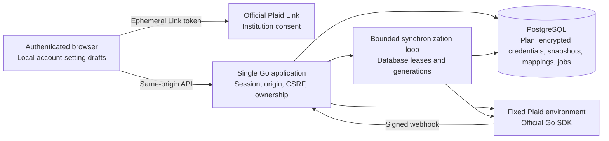
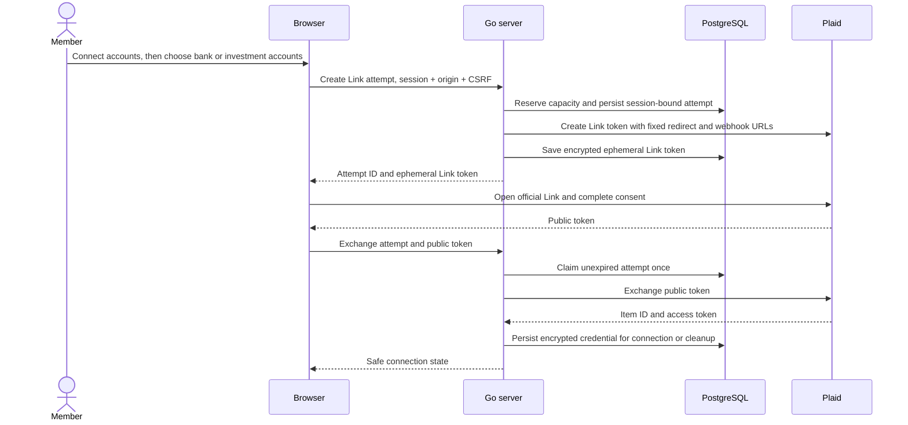
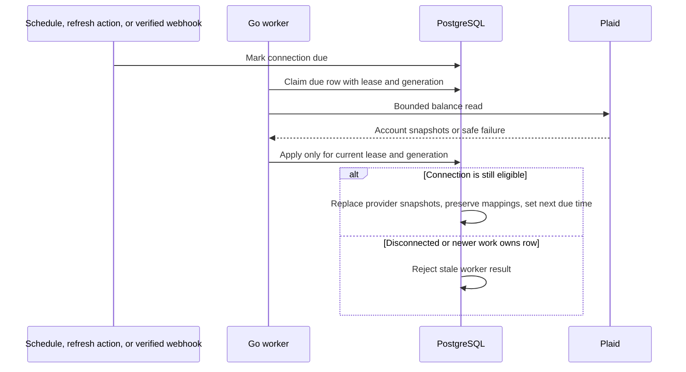

# Read-only Plaid connections

Bank Piggy can link accounts for the existing private household. It keeps provider credentials, imported account snapshots, and the editable plan in separate records. Bank Piggy never collects bank passwords or verification codes. Members complete the institution or Plaid Link consent flow.

This is a balance integration. It does not move money, place trades, retrieve transaction history, change budgets, or infer goal progress. The personal view is a presentation choice. Both household members can read shared financial data.

## Product choice and cost boundary

A new connection has one of two purposes:

| Connection               | Link product | Balance read            | Meaning                                                                                                                                       |
| ------------------------ | ------------ | ----------------------- | --------------------------------------------------------------------------------------------------------------------------------------------- |
| Bank checking or savings | Auth         | `/accounts/balance/get` | A scheduled balance request to the institution. Auth establishes the connection. Bank Piggy does not call `/auth/get` or use routing numbers. |
| Brokerage or retirement  | Investments  | `/accounts/get`         | Cached balance snapshot. A healthy Investments Item normally updates about daily. A read does not force an institution refresh.               |

One **Connect accounts** entry opens a guided account-type choice. Each institution then uses the smallest supported product set for its purpose. After saving, the member can add another institution through the same entry. Plaid does not permit Balance as the only Link initialization product. Requiring Auth and Investments together would exclude institutions that support only one. Nonconnection Auth methods, including micro-deposits, are disabled. Investments initialization can cause Plaid to prepare investment history. Bank Piggy does not fetch or store that history.

Native Plaid Multi-Item Link applies the same product settings to every institution. It does not remove the required-product filter, and the documented API has no per-session Item cap. Bank Piggy therefore uses guided, single-institution consent rather than enabling native Multi-Item Link. This preserves bank and brokerage coverage and the conservative one-reservation-per-attempt allowance. See [Multi-Item Link](https://plaid.com/docs/link/multi-item-link/) and [product initialization](https://plaid.com/docs/link/initializing-products/).

The Auth consent can include account and routing permissions even though this application only uses balances. Members must review the provider's consent screen. The app does not initialize Transactions, Identity, Liabilities, payment, or transfer products. A future transaction product needs its own cursor, correction, removal, and transfer rules.

`/accounts/get` is free and cached. `/accounts/balance/get` is billed per successful request outside an applicable allowance. Auth-only cached balances can be 30 days old or older, so polling that cached endpoint alone would not meet the bank-balance goal. See [Balance](https://plaid.com/docs/balance/), [product initialization](https://plaid.com/docs/link/initializing-products/), and the [Accounts API](https://plaid.com/docs/api/accounts/).

The eligible Trial plan includes Balance and Investments. Its limit is **10 created production Items across the Plaid team**, for the lifetime of the allowance. An Item represents an institution login and can include several accounts. Deleting an Item does not restore capacity. Duplicate Items also consume capacity. Calls on existing Trial Items are not capped by the Item allowance. These published rules do not establish this team's eligibility or remaining capacity. See [Trial rules](https://plaid.com/docs/account/billing/#trial-plans) and [Trial details](https://support.plaid.com/hc/en-us/articles/39994173227159-What-is-the-Plaid-Trial-plan).

Sandbox is the development environment. Production is forbidden in anonymous demo mode and requires HTTPS callback URLs. It remains disabled until an operator checks the team's actual Dashboard plan and created-Item count, then configures an approved remaining budget. Local reservations are conservative and do not discover Items created by other apps on that team. Coordinate all team use. A canceled or uncertain Link attempt can consume the local reservation. Do not restore reservations after deletion or retry an ambiguous creation. Use update mode for existing connections. No billing, checkout, or paid-plan upgrade is part of Bank Piggy.

Capital One, Robinhood, Principal, Huntington, BMO US, Traditional and Roth retirement accounts, high-yield savings, and HSAs are coverage targets. No exact institution or account type is verified by the code or by a Sandbox fixture. Keep unsupported accounts manual.

## Ownership and trust boundaries



The server derives household and member identity from its existing session. Browser-supplied identifiers are lookup keys within that authorized household. Connection reads, mappings, jobs, and notifications also stay inside the configured Sandbox or Production environment. Disabled provider access uses the manual projection. They do not grant access. Link attempts also bind to the current opaque session hash. Only the member who created a connection can reconnect or disconnect it. Household members share balance reads and explicit account mappings. They never receive the access token, Item ID, or provider account ID.

Browser mutations retain the existing exact-origin and session CSRF checks. The webhook route has a separate provider trust boundary. Demo still requires explicit demo mode and a loopback listener. Private mode still requires complete Google identity configuration. Leaving Plaid disabled leaves the manual planner available. Enabling incomplete provider or encryption configuration fails closed.

## Link and exchange



OAuth institutions can leave the app and return to `/plaid-return`. The browser resumes the same Link token through the authenticated pending-attempt endpoint. It does not store Link tokens in browser storage. The server uses its own attempt to decide whether this is a new connection or an update. A deliberate retry creates a fresh Link token. Production tokens are generally one-use; reusing a canceled token can fail even when Sandbox permits it. Only continuation of the same OAuth session uses the pending token. Previous local reservations remain consumed. See [invalid Link token guidance](https://plaid.com/docs/errors/invalid-input/#invalid_link_token). A public token cannot select a household, member, or Item. Optional request fields are omitted when absent; explicit `null` is rejected. A lost completion response is resolved only by the exact server-owned `lastCompletedAttemptId` and an eligible connection state. An existing connection alone cannot prove that reconnect finished. The browser keeps retry state and blocks another Link action until the uncertain attempt is resolved.

Plaid can create an Item when consent finishes, before the browser sends a public token to Bank Piggy. A browser crash in that gap can leave an Item that the server cannot revoke. Closing or expiring a local Link attempt does not prove provider access was removed. The UI must identify unconfirmed removal and direct the member to Plaid or institution access settings.

Provider exchange and a PostgreSQL commit cannot form one distributed transaction. A process crash after Plaid returns a new credential and before that credential reaches durable storage is another recovery risk. An ambiguous attempt must not be silently exchanged again. The operator must inspect and remove the orphaned Item in the Plaid Dashboard. The lifetime reservation remains consumed. Saved cleanup credentials must remain encrypted until removal succeeds. Do not declare an exchange or cleanup successful after a failed commit.

## Snapshots, mapping, and totals

The dedicated **Accounts** view reads all raw account snapshots from the authorized connection list. Account visibility does not depend on inclusion in the planner, classification, currency, or support for the current asset totals. Returned credit and loan balances are labeled as debt. It does not add provider balances in the browser or claim a complete assets/debt/net-worth projection. Planning period and personal-allocation controls do not apply to this view. A shared status reader keeps the visible list current with stored results; it does not call provider refresh endpoints or broaden consent.

| Record           | Responsibility                                                                                                             |
| ---------------- | -------------------------------------------------------------------------------------------------------------------------- |
| Household plan   | User-entered income, expenses, goals, manual accounts, payroll, and revision.                                              |
| Connection       | Connecting member, connection purpose, encrypted access token, lifecycle state, due time, lease, generation, and failures. |
| Link attempt     | Session and household binding, expiry, encrypted transient tokens, and one-use state.                                      |
| Imported account | Stable internal ID, stable provider identifier, current snapshot, active flag, and separate mapping revision.              |
| Mapping          | Explicit inclusion, classification, personal or shared ownership, and optional manual-account replacement.                 |
| Item budget      | Durable environment reservation count. Removal does not reduce it.                                                         |
| Webhook receipt  | A bounded-retention replay identifier used to make repeated notifications safe.                                            |

Imported accounts start outside totals. A member confirms ownership and classification, then includes the account. Do not infer Roth, Traditional, or high-yield status from a name. A refresh replaces provider fields and preserves the saved mapping. A mapping uses its own expected revision. A stale mapping cannot erase a newer choice. `ConnectionList.planRevision` identifies the plan read in the same repeatable-read database snapshot. The browser uses effective totals only when that revision matches its saved plan. It retains mounted mapping drafts while a newer projection loads.

Manual-to-connected reconciliation is explicit. Institution name and matching last four digits are labels, not identity evidence. One eligible mapped snapshot replaces one manual snapshot in the **effective balance projection**. The stored manual account remains in the editable plan. A missing or unsupported connected value must not silently replace a known manual amount with zero.

An account shown to both partners should be included once with shared ownership. If the same real account appears through two logins, include one copy and exclude the other. The application cannot prove cross-Item identity from a name or mask. Household totals count shared ownership once. Personal shares use exact cent reconciliation, with the remaining cent assigned consistently.

The provider response is decoded from decimal text. Integer arithmetic converts amounts to cents without rounding. A value with unsupported fractional-cent precision stays unavailable; it does not block other account values or become zero. Malformed and out-of-range amounts still reject the snapshot. Current and available balances remain separate; totals use current balance. Missing values stay absent. Negative balances remain negative. Non-USD and unclassified or unsupported accounts remain visible but do not enter USD totals. The app does not convert currencies or add balances of different currencies.

Effective balances are a read projection. They cannot update take-home pay, allocation percentages, goal contributions, saved goal progress, payroll estimates, To-do completion, or the plan revision. Yearly and paycheck views do not multiply balance snapshots.

## Scheduled synchronization and webhooks



The worker lives in the existing Go process. PostgreSQL owns the durable due time and lease. Restarting the app resumes due work after an expired lease. Another worker cannot apply data through an older generation. No Redis or separate Railway service is required.

Bank Balance requests supply a UTC `min_last_updated_datetime` no older than the 24-hour synchronization interval. Plaid requires this bound for certain cached-only accounts, including Capital One non-depository accounts and Apple Card. Other institutions may ignore it and retrieve current balances. A stale-cache rejection never triggers an unbounded read or a silent fallback. Investment reads retain the cached `/accounts/get` endpoint. See the [Balance API](https://plaid.com/docs/api/products/signal/#accountsbalanceget).

Provider calls use fixed SDK endpoints, response-size bounds, timeouts, and bounded concurrency. Normal successful reads schedule the next read after 24 hours. Failure records use backoff delays of 1, 2, 4, 8, and 16 minutes. Automatic work stops after five failed jobs, including snapshot-persistence failures when the connection row can record them. The final recorded due time does not cause a sixth attempt. A database outage can prevent failure recording; lease expiry permits recovery after the database returns. A permitted explicit refresh, reconnect, or relevant provider recovery event can reset that failure budget. Manual refresh has a one-hour successful-read cooldown. Disconnect retries retain their encrypted credential even when the automatic failure budget is exhausted. Reconnect-required errors stop normal data refresh until consent is repaired. User actions and duplicate notifications do not create an unbounded worker for each request. A delayed connection keeps its previous successful snapshot and timestamp. When automatic work is stopped or consent is required, the API returns no promised next check. New-account and expiring-consent notices remain visible through ordinary successful or failed reads until an explicit update resolves them. A local synchronization time is not an institution's freshness time. The UI shows provider freshness only when supplied. Scheduled updates are not real-time prices or a guarantee of daily institution availability.

The dedicated `/api/plaid/webhook` endpoint verifies the `Plaid-Verification` JSON Web Token before it reads the notification as financial data. It accepts only ES256 signatures, retrieves the key from the fixed authenticated Plaid endpoint, checks key identity and expiry, rejects stale tokens and future-issued tokens beyond a small clock tolerance, and compares SHA-256 of the exact body bytes in constant time. Body size and verification work are bounded. Key caching must support rotation and remain bounded. There is no public signature bypass. See [official webhook verification](https://plaid.com/docs/api/webhooks/webhook-verification/).

## Reconnect and disconnect

```mermaid
sequenceDiagram
    actor Owner as Connecting member
    participant App as Go server
    participant DB as PostgreSQL
    participant P as Plaid
    Owner->>App: Reconnect with session + origin + CSRF
    App->>DB: Authorize existing connection and save update attempt
    App->>P: Create update-mode Link using existing access token
    P-->>Owner: Consent flow
    Owner->>App: Finish same update attempt
    App->>DB: Queue authoritative account refresh
    Note over App,P: Existing Item and access token remain in use
    Owner->>App: Disconnect with session + origin + CSRF
    App->>DB: Mark disconnecting and invalidate older work
    App->>P: Remove existing Item
    alt Provider removal succeeds
        App->>DB: Remove credential and imported data; finalize state
        App-->>Owner: Disconnected
    else Provider removal fails
        App->>DB: Keep encrypted credential and retry state
        App-->>Owner: Explain failure; allow retry
    end
```

Disconnect excludes the connection from new effective balances as soon as its state changes. An older synchronization cannot restore its snapshots or state. Provider removal must succeed before the server discards the only usable revocation credential. A failed provider call is not a successful disconnect. Restart recovery must continue pending removal. An already removed Item is handled as an idempotent removal result, not as a reason to recreate it.

## Encryption and operations

Access tokens use AES-256-GCM through Go's standard cryptographic library. Each encryption uses a fresh random nonce. Authenticated context binds ciphertext to its household, record, and purpose. A configured key ID selects the active key; old keys remain available to decrypt existing records. Database ciphertext is not useful without the separately stored server key ring.

Keep keys in private runtime secrets. Never put provider secrets, access tokens, encryption keys, or transient Link tokens in Vite variables, build arguments, URLs, logs, analytics, screenshots, or source control. Do not enable SDK debug logging. Server errors expose fixed safe codes and messages.

There is no in-app key migration command. For key rotation, back up the database and current key ring separately. Add a new random 32-byte key under a new ID and make that ID active. Keep the old key IDs available while existing credentials use them. Keep old keys until all dependent records are removed. Re-encryption of retained records requires a separately reviewed offline migration. Do not delete a key while an active credential, pending attempt, cleanup record, or retained backup needs it. Restore tests must include both data and the matching keys. Losing the keys requires new consent and manual Dashboard cleanup; the database alone cannot recover access.

Database migrations are additive and run with existing startup migrations. They do not seed fictional bank accounts or modify plan data. Back up before deployment. Rolling back the image does not remove the new tables or revoke existing Items. Before disabling a release, either keep a compatible worker running until pending removals finish or remove Items through the Dashboard. Disabling Plaid does not itself revoke consent.

Deployment settings and release checks are in [deployment](deployment.md). Local results and independent review outcomes are in [Plaid verification](plaid-verification.md). Local test evidence is recorded separately from Sandbox, live institution, and deployed release evidence. Provider simulations establish application behavior; they do not establish Plaid availability, institution coverage, Trial eligibility, or backup recovery.

## Alternatives and remaining risks

- Transactions would supply regular bank updates, but adds activity consent, data retention, cursor pagination, corrections, and removal processing. The chosen bank flow uses Balance and avoids that unused product.
- Polling cached Auth balances alone is smaller but can present data that is weeks old. It does not meet automatic bank-balance updates.
- One combined Auth and Investments Link would exclude useful institutions. Separate purposes keep coverage honest.
- Writing provider balances into the JSON plan would create conflicts and could erase user edits. Separate snapshots and effective projections preserve draft ownership.
- A separate queue service adds infrastructure without a measured need for this household. Database leases supply durable ownership in one deployment.
- Cross-login joint-account identity, a simultaneous provider/database failure, external team usage, institution outages, live OAuth behavior, and backup restore still require operational evidence. No security-compliance claim follows from these controls.

## Monthly activity boundary

Balance changes are not transaction history. A brokerage balance increase can include contributions, market gains, dividends, interest, transfers, or corrections. The agreed future metric is net contributions, with trades and returns separate. Funding from checking into investments counts toward investment contributions; moving money between investment accounts does not create new household funding. A complete implementation must handle source coverage, dates, corrections, duplicate transfers, withdrawals, and incomplete history before it reports a monthly total.

Monthly spending requires the [Transactions product](https://plaid.com/docs/transactions/). Bank/card purchases and refunds need a durable activity ledger, with transfers and credit-card payments reconciled so the same purchase is counted once. Investment activity uses the [Investments endpoints](https://plaid.com/docs/investments/). Buying securities is not automatically a new contribution, and reinvested dividends are not new external cash.

No transaction endpoints or new products were enabled for the Accounts dashboard. Transactions, Liabilities, and Investments Transactions can add production subscription costs; calling investment transaction history can add a separate subscription from Holdings. Team access, consent, coverage, retention, and billing must be checked before enabling this next phase. See [Plaid billing](https://plaid.com/docs/account/billing/). Existing credit/loan rows can be displayed now, but standalone card-only linking remains a separate product decision because the current Auth flow requires a debitable account.
