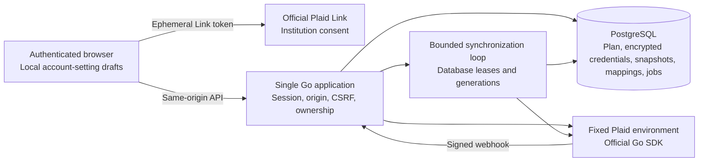
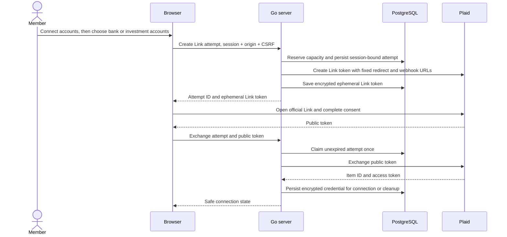
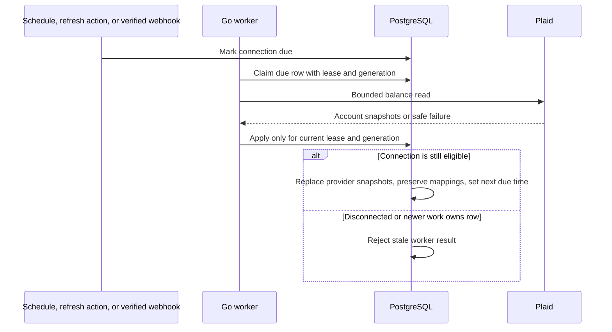

# Read-only Plaid connections

Bank Piggy can link accounts for the existing private household. It keeps provider credentials, imported account snapshots, and the editable plan in separate records. Bank Piggy never collects bank passwords or verification codes. Members complete the institution or Plaid Link consent flow.

Balances and Activity use separate records and provider jobs. Activity can read history for existing connections after operator approval, source opt-in, and the required consent. It does not move money, place trades, overwrite expense budgets, or infer goal progress. A confirmed pay suggestion can change only one member's net-pay estimate, pay frequency, and pay calendar. Both household members can read shared financial data.

## Product choice and cost boundary

A new connection has one of two purposes:

| Connection               | Link product | Balance read            | Meaning                                                                                                                                       |
| ------------------------ | ------------ | ----------------------- | --------------------------------------------------------------------------------------------------------------------------------------------- |
| Bank checking or savings | Auth         | `/accounts/balance/get` | A scheduled balance request to the institution. Auth establishes the connection. Bank Piggy does not call `/auth/get` or use routing numbers. |
| Brokerage or retirement  | Investments  | `/accounts/get`         | Cached balance snapshot. A healthy Investments Item normally updates about daily. A read does not force an institution refresh.               |

One **Connect accounts** entry opens a guided account-type choice. Each institution then uses the smallest supported product set for its purpose. After saving, the member can add another institution through the same entry. Plaid does not permit Balance as the only Link initialization product. Requiring Auth and Investments together would exclude institutions that support only one. Nonconnection Auth methods, including micro-deposits, are disabled. Investments initialization can prepare history, but the ordinary balance flow does not request or store it. The separate Activity opt-in controls history reads.

Native Plaid Multi-Item Link applies the same product settings to every institution. It does not remove the required-product filter, and the documented API has no per-session Item cap. Bank Piggy therefore uses guided, single-institution consent rather than enabling native Multi-Item Link. This preserves bank and brokerage coverage and the conservative one-reservation-per-attempt allowance. See [Multi-Item Link](https://plaid.com/docs/link/multi-item-link/) and [product initialization](https://plaid.com/docs/link/initializing-products/).

The Auth consent can include account and routing permissions even though the balance integration does not use routing numbers. Members must review the provider's consent screen. Ordinary new Link does not add Transactions. Activity requests its consent separately on an existing Item. The app does not initialize Identity, Liabilities, payment, or transfer products.

`/accounts/get` is free and cached. `/accounts/balance/get` is billed per successful request outside an applicable allowance. Auth-only cached balances can be 30 days old or older, so polling that cached endpoint alone would not meet the bank-balance goal. See [Balance](https://plaid.com/docs/balance/), [product initialization](https://plaid.com/docs/link/initializing-products/), and the [Accounts API](https://plaid.com/docs/api/accounts/).

An Item represents an institution login and can include several accounts. Check the actual team's Dashboard for Trial eligibility, approved products, Item allowance, remaining capacity, and billing terms. A public Trial description does not prove this team's allowance. Local reservations do not discover other apps' Items and are not refunded by deletion. See [Plaid billing and plans](https://plaid.com/docs/account/billing/) and [Trial details](https://support.plaid.com/hc/en-us/articles/39994173227159-What-is-the-Plaid-Trial-plan).

Sandbox is the development environment. Production is forbidden in anonymous demo mode and requires HTTPS callback URLs. It remains disabled until an operator checks the team's actual Dashboard plan and created-Item count, then configures an approved remaining budget. Local reservations are conservative and do not discover Items created by other apps on that team. Coordinate all team use. A canceled or uncertain Link attempt can consume the local reservation. Do not restore reservations after deletion or retry an ambiguous creation. Use update mode for existing connections. No billing, checkout, or paid-plan upgrade is part of Bank Piggy.

Capital One, Robinhood, Principal, Huntington, BMO US, Traditional and Roth retirement accounts, high-yield savings, and HSAs are coverage targets. No exact institution or account type is verified by the code or by a Sandbox fixture. Keep unsupported accounts manual.

## Ownership and trust boundaries



The server derives household and member identity from its existing session. Browser-supplied identifiers are lookup keys within that authorized household. Connection reads, mappings, jobs, and notifications also stay inside the configured Sandbox or Production environment. Disabled provider access uses the manual projection. They do not grant access. Link attempts also bind to the current opaque session hash. Only the member who created a connection can reconnect or disconnect it. Household members share balance reads and explicit account mappings. They never receive the access token, Item ID, or provider account ID.

Browser mutations retain the existing exact-origin and session CSRF checks. The webhook route has a separate provider trust boundary. Demo still requires explicit demo mode and a loopback listener. Private mode still requires complete Google identity configuration. Leaving Plaid disabled leaves the manual planner available. Enabling incomplete provider or encryption configuration fails closed.

## Link and exchange



OAuth institutions can leave the app and return to `/plaid-return`. The browser resumes the same Link token through the authenticated pending-attempt endpoint. It does not store Link tokens in browser storage. The server persists the attempt purpose, `balances` or `activity`, and decides whether the attempt is a new connection or an update. Activity requires an existing connection and never exchanges a new public token. Recovery retains that purpose and the original session, household, member, and settings revision. A deliberate retry creates a fresh Link token. Production tokens are generally one-use; reusing a canceled token can fail even when Sandbox permits it. Only continuation of the same OAuth session uses the pending token. Previous local reservations remain consumed. See [invalid Link token guidance](https://plaid.com/docs/errors/invalid-input/#invalid_link_token). A public token cannot select a household, member, or Item. Optional request fields are omitted when absent; explicit `null` is rejected. A lost completion response is resolved only by the exact server-owned `lastCompletedAttemptId` and an eligible connection state. An existing connection alone cannot prove that reconnect finished. The browser keeps retry state and blocks another Link action until the uncertain attempt is resolved.

Plaid can create an Item when consent finishes, before the browser sends a public token to Bank Piggy. A browser crash in that gap can leave an Item that the server cannot revoke. Closing or expiring a local Link attempt does not prove provider access was removed. The UI must identify unconfirmed removal and direct the member to Plaid or institution access settings.

Provider exchange and a PostgreSQL commit cannot form one distributed transaction. A process crash after Plaid returns a new credential and before that credential reaches durable storage is another recovery risk. An ambiguous attempt must not be silently exchanged again. The operator must inspect and remove the orphaned Item in the Plaid Dashboard. The lifetime reservation remains consumed. Saved cleanup credentials must remain encrypted until removal succeeds. Do not declare an exchange or cleanup successful after a failed commit.

## Snapshots, mapping, and totals

The dedicated **Accounts** view reads all raw account snapshots from the authorized connection list. Account visibility does not depend on inclusion in the planner, classification, currency, or support for the current asset totals. Returned credit and loan balances are labeled as debt. It does not add provider balances in the browser or claim a complete assets/debt/net-worth projection. Planning period and personal-allocation controls do not apply to this view. A shared status reader keeps the visible list current with stored results; it does not call provider refresh endpoints or broaden consent.

| Record           | Responsibility                                                                                                             |
| ---------------- | -------------------------------------------------------------------------------------------------------------------------- |
| Household plan   | User-entered income, expenses, goals, manual accounts, payroll, and revision.                                              |
| Connection       | Connecting member, connection purpose, encrypted access token, lifecycle state, due time, lease, generation, and failures. |
| Link attempt     | Session and household binding, expiry, encrypted transient tokens, and one-use state.                                      |
| Imported account | Stable internal ID, stable provider identifier, current snapshot, active flag, and separate mapping revision.              |
| Mapping          | Explicit inclusion, classification, personal or shared ownership, and optional manual-account replacement.                 |
| Item budget      | Durable environment reservation count. Removal does not reduce it.                                                         |
| Webhook receipt  | A bounded-retention replay identifier used to make repeated notifications safe.                                            |
| Activity job     | Separate source settings, consent, cursor, history coverage, due time, lease, generation, and failure budget.              |
| Activity record  | Internal raw provider facts, cancellation state, legacy classification, pair, frozen allocation, and revision.             |
| Cancellation ID  | Internal identifier retained after an investment cancellation payload leaves the history window.                           |

Untouched supported USD accounts use server-owned inclusion defaults under the institution's connecting member. A mapping at revision one with disabled/unclassified fields and no manual replacement means no member choice has been saved. Reads resolve checking, savings, HSA, and brokerage defaults only from provider type/subtype; other investments use a neutral Other investment classification. Unknown bank subtypes and unsupported currencies/types stay excluded. A missing current value never becomes zero. The returned account mapping and effective projection use the same resolved default. Reads do not write these defaults to the database. Any saved mapping revision replaces the defaults and remains unchanged by refreshes, including an explicit exclusion. Do not infer Roth, Traditional, or high-yield status from a name. A refresh replaces provider fields and preserves the saved mapping. A mapping uses its own expected revision. A stale mapping cannot erase a newer choice. `ConnectionList.planRevision` identifies the plan read in the same repeatable-read database snapshot. The browser uses effective totals only when that revision matches its saved plan. It retains mounted mapping drafts while a newer projection loads. Overview withholds balance totals until that projection matches; it does not silently label old manual figures as current linked balances. Matched manual editor rows show a read-only projected Plaid amount and leave the saved manual fallback unchanged.

Manual-to-connected reconciliation is explicit. Institution name and matching last four digits are labels, not identity evidence. One eligible mapped snapshot replaces one manual snapshot in the **effective balance projection**. The stored manual account remains in the editable plan. A missing or unsupported connected value must not silently replace a known manual amount with zero.

An account shown to both partners should be included once with shared ownership. If the same real account appears through two logins, include one copy and exclude the other. The application cannot prove cross-Item identity from a name or mask. Household totals count shared ownership once. Personal shares use exact cent reconciliation, with the remaining cent assigned consistently.

The provider response is decoded from decimal text. Integer arithmetic converts amounts to cents without rounding. A value with unsupported fractional-cent precision stays unavailable; it does not block other account values or become zero. Malformed and out-of-range amounts still reject the snapshot. Current and available balances remain separate in storage; the account list and totals show current balance only. Credit and loan rows use Amount owed. Missing values stay absent. Negative balances remain negative. Non-USD and unclassified or unsupported accounts remain visible but do not enter USD totals. The app does not convert currencies or add balances of different currencies.

Effective balances are a read projection. They cannot update take-home pay, allocation percentages, goal contributions, saved goal progress, payroll estimates, To-do completion, or the plan revision. Yearly and paycheck views do not multiply balance snapshots.

## Scheduled synchronization and webhooks



The worker lives in the existing Go process. PostgreSQL owns the durable due time and lease. Restarting the app resumes due work after an expired lease. Another worker cannot apply data through an older generation. No Redis or separate Railway service is required.

Bank Balance requests supply a UTC `min_last_updated_datetime` with an independent 24-hour maximum cache age. This bound does not change with the 30-minute read cadence. Plaid requires it for certain cached-only accounts, including Capital One non-depository accounts and Apple Card. Other institutions may ignore it and retrieve current balances. A stale-cache rejection never triggers an unbounded read or a silent fallback. Investment reads retain the cached `/accounts/get` endpoint. See the [Balance API](https://plaid.com/docs/api/products/signal/#accountsbalanceget).

Provider calls use fixed SDK endpoints, response-size bounds, timeouts, and bounded concurrency. Successful balance reads schedule the next read after 30 minutes. Failed reads also wait 30 minutes. A claimed balance job reserves that next deadline before contacting Plaid, so a crashed worker's shorter two-minute ownership lease cannot trigger an early read. Manual refresh and balance webhooks honor both the 30-minute successful-read cooldown and the next due time. Error notifications preserve a future deadline. First import, explicit reconnect, and login repair can read immediately.

Automatic balance work stops after five failed jobs, including snapshot-persistence failures when the connection row can record them. The final recorded due time does not cause a sixth attempt. A database outage can prevent failure recording; lease expiry and the saved read deadline permit recovery after the database returns. A permitted explicit refresh, reconnect, or relevant provider recovery event can reset that failure budget. Disconnect cleanup retains its earlier 1, 2, 4, 8, and 16-minute retry delays and encrypted credential even when the automatic failure budget is exhausted. Reconnect-required errors stop normal data refresh until consent is repaired. User actions and duplicate notifications do not create an unbounded worker for each request. A delayed connection keeps its previous successful snapshot and timestamp. When automatic work is stopped or consent is required, the API returns no promised next check. New-account and expiring-consent notices remain visible through ordinary successful or failed reads until an explicit update resolves them. A local synchronization time is not an institution's freshness time. The API retains provider freshness when supplied. The simplified account list omits update timestamps and shows connection problems and the approximate check cadence instead. Scheduled updates are not real-time prices or a guarantee of institution availability.

The dedicated `/api/plaid/webhook` endpoint verifies the `Plaid-Verification` JSON Web Token before it reads the notification as financial data. It accepts only ES256 signatures, retrieves the key from the fixed authenticated Plaid endpoint, checks key identity and expiry, rejects stale tokens and future-issued tokens beyond a small clock tolerance, and compares SHA-256 of the exact body bytes in constant time. Body size and verification work are bounded. Key caching must support rotation and remain bounded. There is no public signature bypass. See [official webhook verification](https://plaid.com/docs/api/webhooks/webhook-verification/).

## Reconnect and disconnect

```mermaid
sequenceDiagram
    actor Owner as Connecting member
    participant App as Go server
    participant DB as PostgreSQL
    participant P as Plaid
    Owner->>App: Reconnect with session + origin + CSRF
    App->>DB: Authorize existing connection and save update attempt
    App->>P: Create update-mode Link using existing access token
    P-->>Owner: Consent flow
    Owner->>App: Finish same update attempt
    App->>DB: Queue authoritative account refresh
    Note over App,P: Existing Item and access token remain in use
    Owner->>App: Disconnect with session + origin + CSRF
    App->>DB: Mark disconnecting and invalidate older work
    App->>P: Remove existing Item
    alt Provider removal succeeds
        App->>DB: Remove credential and imported data; finalize state
        App-->>Owner: Disconnected
    else Provider removal fails
        App->>DB: Keep encrypted credential and retry state
        App-->>Owner: Explain failure; allow retry
    end
```

Disconnect excludes the connection from new effective balances and activity reads as soon as its state changes. An older synchronization cannot restore its snapshots or state. Provider removal must succeed before the server discards the only usable revocation credential. A failed provider call is not a successful disconnect. Restart recovery must continue pending removal. An already removed Item is handled as an idempotent removal result, not as a reason to recreate it. Account revocation cascades its stored activity and cancellation IDs. Item revocation clears activity and its history authorization. Completed disconnect purges activity jobs, records, and cancellation IDs. Surviving paired reviews are cleared and versioned before affected records disappear.

## Encryption and operations

Access tokens use AES-256-GCM through Go's standard cryptographic library. Each encryption uses a fresh random nonce. Authenticated context binds ciphertext to its household, record, and purpose. A configured key ID selects the active key; old keys remain available to decrypt existing records. Database ciphertext is not useful without the separately stored server key ring.

Keep keys in private runtime secrets. Never put provider secrets, access tokens, encryption keys, or transient Link tokens in Vite variables, build arguments, URLs, logs, analytics, screenshots, or source control. Do not enable SDK debug logging. Server errors expose fixed safe codes and messages.

There is no in-app key migration command. For key rotation, back up the database and current key ring separately. Add a new random 32-byte key under a new ID and make that ID active. Keep the old key IDs available while existing credentials use them. Keep old keys until all dependent records are removed. Re-encryption of retained records requires a separately reviewed offline migration. Do not delete a key while an active credential, pending attempt, cleanup record, or retained backup needs it. Restore tests must include both data and the matching keys. Losing the keys requires new consent and manual Dashboard cleanup; the database alone cannot recover access.

Database migrations are additive and run with existing startup migrations. They do not seed fictional bank accounts or modify plan data. Back up before deployment. Rolling back the image does not remove the new tables or revoke existing Items. Before disabling a release, either keep a compatible worker running until pending removals finish or remove Items through the Dashboard. Disabling Plaid does not itself revoke consent.

Deployment settings and release checks are in [deployment](deployment.md). Existing balance evidence is in [Plaid verification](plaid-verification.md); new history evidence belongs in [Activity verification](activity-verification.md). Local test evidence is recorded separately from Sandbox, live institution, and deployed release evidence. Provider simulations establish application behavior; they do not establish Plaid availability, institution coverage, Trial eligibility, or backup recovery.

## Alternatives and remaining risks

- Balance and Activity remain separate. History requires additional cost approval, consent, provider pagination, corrections, and removal handling. It is not activated by ordinary balance linking or status reads.
- Polling cached Auth balances alone is smaller but can present data that is weeks old. It does not meet automatic bank-balance updates.
- One combined Auth and Investments Link would exclude useful institutions. Separate purposes keep coverage honest.
- Writing provider balances into the JSON plan would create conflicts and could erase user edits. Separate snapshots and effective projections preserve draft ownership.
- A separate queue service adds infrastructure without a measured need for this household. Database leases supply durable ownership in one deployment.
- Cross-login joint-account identity, a simultaneous provider/database failure, external team usage, institution outages, live OAuth behavior, and backup restore still require operational evidence. No security-compliance claim follows from these controls.

## Activity consent and cost

`PLAID_BANK_ACTIVITY_APPROVED` and `PLAID_INVESTMENT_ACTIVITY_APPROVED` are independent operator access/cost gates. Both default to false. Existing connections remain off until the linking member saves a source opt-in. Investment opt-in uses existing Investments consent. Bank opt-in stays `consent_required` until the same session completes an activity-purpose update attempt with `additional_consented_products=[transactions]`. Reconnect repairs the existing connection separately. Update mode keeps the same Item and access token; it does not need a public-token exchange. [Plaid update mode](https://plaid.com/docs/link/update-mode/)

The first investment history call can add Investments Transactions beyond the existing Holdings subscription. Bank history calls can activate Transactions after consent. Review the actual Trial or paid agreement and disclose this before opt-in. Turning history off invalidates in-flight activity work and stops future history reads. It does not remove the Item or end a provider subscription. Account inclusion also does not change provider permissions or billing. [Product initialization](https://plaid.com/docs/link/initializing-products/) and [subscription rules](https://plaid.com/docs/account/billing/)

Source account inclusion and ownership are separate from asset balance mappings. Eligible active USD accounts default on before a first settings save, except a saved balance exclusion. Later imports default off. Credit accounts do not depend on the asset-enabled flag. Account choices control totals; the application can retain eligible history returned for other consented accounts on the Item. Both household members can read the household history. Only the linking member can change source settings.

## Activity ingestion and coverage

`GET /api/activity`, Sources, and status reloads read PostgreSQL only. A repeatable-read transaction supplies the plan, sources, internal records, legacy allocations, and full-month totals. The browser response contains aggregates, source settings, and pay estimates only. It has no raw rows, categories, per-target matches, record-review API, or pagination cursor. The activity worker has a separate lease, generation, deadline, cursor, and failure count. Balance failures do not consume its failure budget. Ordinary attempts reserve the next read at least 30 minutes ahead, including failed attempts and crash recovery. First opt-in or consent repair can start immediately. Neither polling nor a webhook forces provider background data to be current. These values are not real time.

One activity attempt can read several provider pages. The cadence limits job starts, not pages. Activity stops after its own five recorded failures. Saving source settings can reset that failure count but does not bypass an existing future read deadline.

Bank ingestion stages every added, modified, and removed page from `/transactions/sync`. Records and the final cursor commit together. A pagination mutation restarts from the original saved cursor with a bounded retry count. Historical readiness must be confirmed before coverage dates are exposed. Investment ingestion stages a fixed 180-day window through bounded offset pages. Changed totals, duplicate IDs, missing pages, or invalid dates reject the whole window and preserve prior data. Offsets have no provider snapshot token; these checks cannot detect every concurrent provider change. [Transactions Sync](https://plaid.com/docs/api/products/transactions/#transactionssync) and [investment history](https://plaid.com/docs/api/products/investments/#investmentstransactionsget)

The save checks both connection and activity generations and the current lease under the household lock. Disable, revocation, disconnect, or a newer settings save invalidates late work. A refresh preserves valid legacy review choices and advances record revisions only for changed facts. Relevant changes to a transfer pair invalidate both reviews. Removed transactions and investment cancellations do not remain counted.

Raw history is bounded to 730 days. Local cleanup also handles disabled sources while the provider service runs. Cancellation identifiers contain no money or descriptions and survive raw-history removal until account or Item purge. Retention clears surviving transfer reviews before deleting their peers. Back up all activity tables with the plan and keep the encryption keys separately. [Data model](data-model.md#connected-activity-records)

Canonical source states are `disabled`, `consent_required`, `initializing`, `ready`, `delayed`, `reconnect`, and `unsupported`. Monthly coverage is `not_connected`, `disabled`, `incomplete`, or `ready`. Coverage refers to selected accounts and the requested month, through today for the current month. Missing history is not zero. Pending, cancelled, unsupported, and unresolved records stay outside confirmed totals. Exact decimal parsing keeps missing or fractional-cent amounts unavailable rather than rounding them to zero.

## Actuals and confirmed pay estimates

Monthly spending is posted bank/card purchases less refunds. Card payments and ordinary transfers do not add income or spending. Net invested is investment deposits less withdrawals. Provider contribution/deposit subtypes take precedence over a trade type; a buy alone is not external funding. Trades, dividends, interest, fees, and market changes stay separate. Possible same-amount funding legs between investment accounts remain excluded with incomplete coverage. Similar amounts and dates do not prove a transfer. Existing explicit pairs remain internal and are resolved before month and personal-scope filtering. Shared ownership counts once for the household and divides cents consistently between members.

The same full-ledger projection supplies aggregate expense Budget, Spent, and Remaining comparisons, investment plan versus net-contribution comparisons, and the Actual Sankey. Yearly and paycheck multipliers apply only to forecasts. The server supplies aggregate bank-flow edges, including positive refund/reversal edges and a balancing surplus or inflow gap. The Actual Sankey has no category-specific flows. The balance is an arithmetic difference, not an account balance or proof of borrowing. Investment contributions stay separate from bank cash flow because payroll and employer contributions can occur outside take-home cash.

There is no transaction-list, record-review, or manual-match API. Raw records remain internal for provider corrections, classification, and pay evidence. Existing expense/goal matches and frozen shares remain readable internally; this increment does not purge them or change retention. New and unmatched records follow account ownership, with reconciled equal shares for shared accounts. Later plan edits do not rewrite valid frozen shares. Provider financial-meaning changes still invalidate affected matches. Recorded activity does not update manual goal progress or infer IRS contribution-year attribution. See the [legacy allocation data model](data-model.md#explicit-target-matches).

Source availability stays conservative across the household even in personal comparisons because a payer can fund another member's allocated share. These comparison changes add no provider products, approval gates, read cadence changes, or new live consent.

Pay suggestions group selected, posted USD paycheck deposits by account and payer over the last 180 days. Exact weekly, biweekly, monthly, or semimonthly evidence is required; ambiguous or stale streams produce no suggestion. The estimate uses a median deposit and flags variable amounts. The browser shows aggregate estimates and proposed fields, without an individual deposit list. A shared account does not establish the wage earner. Confirmation names one existing member and checks both the current evidence and plan revision under the household lock. Only that member's monthly take-home estimate, frequency, and calendar change. Gross pay, taxes, 401(k) splits, matching, expense budgets, balances, and goal progress remain separate.

The shared connection reader still supplies authoritative Accounts and Overview balances. It reloads stored snapshots every 30 minutes while visible and on foreground return. One workspace `ActivityProvider` shares the selected monthly stored-data response across Activity, Money flow, Expenses, and Goals. Opening either view does not broaden consent or request a provider refresh. Standalone card-only linking remains outside this increment; a card returned by an existing bank Item does not prove that coverage.

The aggregate Activity increment has no deployed verification yet. Existing verification records remain historical evidence for their stated versions.
