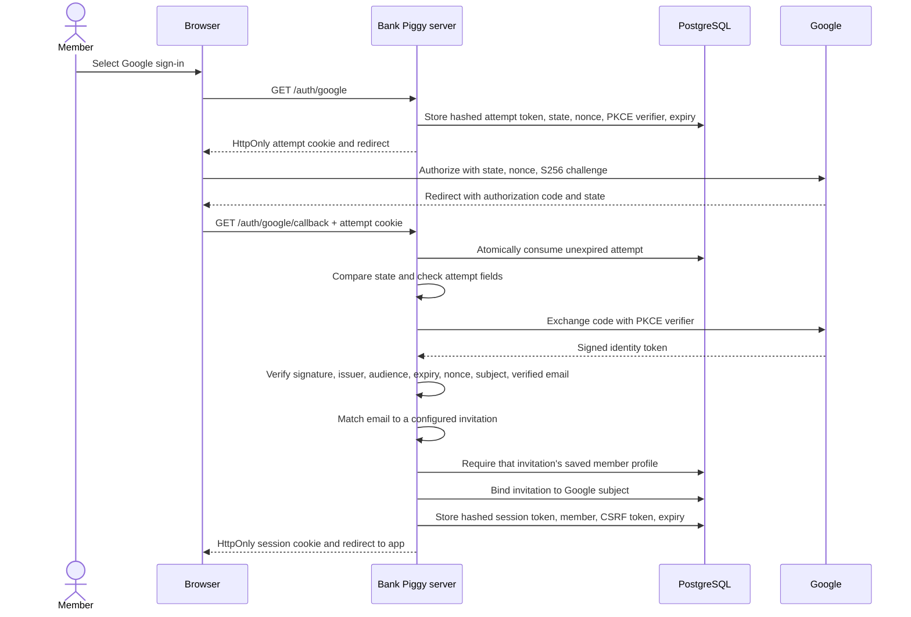

# Security boundaries and defenses

The Go server decides who can read or edit the plan. The browser never selects a household ID. Both invited members have complete access to their shared household; the personal view changes presentation, not permissions.

Household labels are the same in local and private modes. The local entry text **Open household plan** still calls the demo-session endpoint, which requires explicit demo mode and a loopback listener. Interface wording does not establish Google identity or connect bank data.

## Private sign-in

OpenID Connect verifies the Google identity. Bank Piggy then issues its own opaque session token. Google access tokens are not used as application sessions.

**State** ties the callback to the authorization request. **Nonce** ties the identity token to that attempt. **PKCE**, or Proof Key for Code Exchange, requires the server's saved verifier when exchanging the authorization code. The attempt cookie contains a random token; its state, nonce, and verifier remain in PostgreSQL.

The callback consumes the attempt with `DELETE ... RETURNING`. A callback cannot reuse the same attempt. Failed or expired attempts require a new sign-in. One or two configured bootstrap invitations map by order to `member-1` and optional `member-2`. Bootstrap sign-in requires that profile in the saved plan. A household link can append a missing second profile while binding its verified identity. Unique constraints prevent one identity from claiming both members. Later sign-ins must match the saved subject and email.

Each session lookup checks current saved membership and the persisted identity. Bootstrap identities also require their configured invitation. An accepted-link identity carries a persisted acceptance flag and does not require an environment change. An absent member has no authenticated session response or protected access. Saving cannot remove an existing profile; the store checks this rule under the same row lock as the revision.

Household links use a random 32-byte secret, a stored hash, a seven-day expiry, and one-use acceptance. Preparation uses an exact-origin JSON request and an HttpOnly cookie. The Google attempt stores the invitation hash. Claims recheck expiry after acquiring the household lock, then consume the link, pin the identity, and append a missing profile in one transaction. Creating or revoking a link uses that same lock. The link flow grants no access before Google verification.

Normal sign-in ignores and clears pending invitation context. Joining requires an explicit join intent and a valid prepared invitation. Invalid join cookies are cleared, so an expired link cannot block normal sign-in. Acceptance is durable before session issuance; if session storage fails, a normal Google sign-in recovers the accepted membership. See [sharing transaction and failure paths](sharing-payroll-todos.md).

Public sign-in starts and invitation preparation share a bounded per-process request budget. This limits database work without trusting forwarded IP headers or growing an unbounded client map. It supplements token entropy and identity checks; a multi-instance service still needs platform-level rate controls.

Source: [sign-in handlers](../../apps/api/internal/server/oidc.go), [attempt persistence](../../apps/api/internal/store/oidc.go), and [identity queries](../../apps/api/internal/store/queries.go).

## Trust boundaries

| Boundary                         | Implemented defense                                                                                                                                                                          | Failure behavior                                                                                                |
| -------------------------------- | -------------------------------------------------------------------------------------------------------------------------------------------------------------------------------------------- | --------------------------------------------------------------------------------------------------------------- |
| Process configuration → listener | Private mode is the backend default. It requires Google credentials, one or two distinct valid invites, a database URL, and a valid base origin. Non-loopback private origins require HTTPS. | Startup fails instead of opening unconfigured private access.                                                   |
| Local demo → private service     | Demo requires explicit mode, a loopback listener, and a loopback origin. Private mode does not expose demo-session creation.                                                                 | Invalid configuration fails; private demo requests return `404`.                                                |
| Browser cookie → identity        | 32 random bytes per opaque token; SHA-256 token hash stored in PostgreSQL; server-owned household and member IDs.                                                                            | Missing, expired, foreign-mode, unknown-member, or changed-invite sessions are rejected.                        |
| Google callback → member         | One-use attempt, state, nonce, PKCE, library token verification, verified email allowlist, saved membership, pinned subject.                                                                 | Invalid attempt `400`; invalid identity `401`; missing invitation, absent member, or mismatched identity `403`. |
| Browser mutation → plan          | Session lookup, exact `Origin`, nonempty session-specific CSRF header, constant-time token comparison.                                                                                       | Write or logout returns `403` before mutation.                                                                  |
| JSON → domain model              | JSON content type, 128 KiB body limit, one object, all required fields, no unknown fields, and business validation.                                                                          | Invalid plans return `400` and leave the saved plan unchanged.                                                  |
| Plan save → database             | Parameterized, household-scoped queries and row-locked revision and member-count checks.                                                                                                     | Stale save returns `409`; removing a saved member returns `400`; transaction failure does not return success.   |
| API response → frontend          | Generated JSON Schema validated with Ajv.                                                                                                                                                    | Unexpected success payload becomes an actionable client error.                                                  |

Payment schedules and target details pass through the same complete-plan validation and revision transaction. The server rejects unknown payment kinds, malformed provider IDs, invalid or reversed months, duplicate trip cost categories, and amounts outside the money bounds. Optional target objects must contain their required nested fields. Invalid planning-month queries return `400` before a plan update.

Each member must supply an accounts array, including an empty array when no balances are entered. Go checks the 20-account limit, IDs unique within the member, names, supported types, whole-cent balances, and separate savings/investment group limits. Old member aggregate fields are rejected in API writes. Ordinary saved progress requires a positive target and nonnegative saved amount; at most one of ordinary progress, trip details, or purchase details can exist on a goal.

Provider logos stay on the application origin. The frontend resolves an ID through the local catalog before creating an image path; unknown IDs use a generic icon. The asset generator checks for scripts, foreign objects, event-handler attributes, and external references. User-entered provider text does not become a remote image URL or trigger provider authentication. See [provider lookup](../../apps/web/src/features/providers/catalog.ts) and [asset generation](../../scripts/generate-provider-icons.mjs).

CSRF means cross-site request forgery: a different site tries to make an authenticated browser write data. The session cookie alone is insufficient for a mutation. The browser must also send the matching token from its authenticated session response and the exact configured origin.

## Session lifecycle

Session cookies use `HttpOnly`, `SameSite=Lax`, and path `/`. They use `Secure` outside validated loopback HTTP. A session lasts seven days. A new session revokes the previous token presented by that browser. Logout deletes the current server record before clearing the cookie.

Every protected request looks up an unexpired session. It checks the expected mode household and member IDs. Private requests also compare the bound email against the current invitation mapping. Changing invitations can therefore invalidate old sessions; it does not rebind an existing Google identity.

New session and sign-in-attempt creation each prune at most 100 expired rows of their own type. Expired records are never accepted, even if bounded cleanup has not removed them yet. This is issuance-time cleanup, not a scheduled retention worker.

## Data, errors, and resources

The server sets `Cache-Control: no-store`, `X-Content-Type-Options: nosniff`, `Referrer-Policy: no-referrer`, and `X-Frame-Options: DENY`. The referrer policy keeps household invitation links out of outgoing referrer headers. API failures return safe messages. Request error logs record the error type rather than the financial request body, SQL error, session token, or Google credentials.

Requests have a ten-second context deadline. The HTTP server also sets header, read, write, and idle timeouts. PostgreSQL connections close during shutdown. Failed transactions roll back with a bounded cleanup context. These controls limit resource use and preserve the original error.

The repository does not configure database encryption, backups, a deployment firewall, edge rate limits, or operational alerting. Those are deployment decisions and need evidence in the selected hosting environment. The local Compose credentials are sample credentials for the loopback database.

## What the tests prove

- [Configuration tests](../../apps/api/internal/server/config_test.go) check fail-closed startup and cookie transport behavior.
- [HTTP tests](../../apps/api/internal/server/server_test.go) exercise session requirements, exact origin, CSRF, validation, and plan persistence with real PostgreSQL.
- [Private-session tests](../../apps/api/internal/server/private_test.go) reject changed invitations and private-mode demo access.
- [Sign-in attempt tests](../../apps/api/internal/server/oidc_test.go) cover state binding, PKCE parameters, replay, and invitation rejection.
- [Signed-token tests](../../apps/api/internal/server/google_token_test.go) use local RSA signatures and a local public-key endpoint. They reject wrong audience, issuer, expiry, nonce, unverified email, and missing subject.
- [Store tests](../../apps/api/internal/store/store_test.go) cover identity rebinding, uniqueness, expired sessions, and competing plan updates.
- [Projection HTTP tests](../../apps/api/internal/server/projections_test.go) round-trip schedule and trip metadata through JSON and real PostgreSQL, retain the planning month, and reject unsupported month queries before a write.
- [Purchase HTTP tests](../../apps/api/internal/server/purchases_test.go) retain older trip JSON, persist purchase targets, reject incomplete or conflicting target objects, and leave the saved revision unchanged after an invalid write.
- [Account HTTP tests](../../apps/api/internal/server/accounts_test.go) require complete account records, reject noncanonical aggregates, and preserve saved data after invalid writes.
- [Ordinary progress HTTP tests](../../apps/api/internal/server/savings_targets_test.go) preserve manual progress while keeping account balances and monthly allocations unchanged.

These tests include a simulated identity provider. They do not prove live Google consent, deployed cookie behavior, or access to bank data. Optional Plaid credentials and synchronization now have separate trust boundaries. See [Plaid security and lifecycle](plaid.md#ownership-and-trust-boundaries). Local provider simulations do not establish live bank access.

## Plaid provider boundary

Plaid is disabled by default. Enabling it requires explicit environment, server credentials, and a valid AES-256-GCM key ring. Production also requires confirmed Trial access and an approved lifetime reservation budget. The server retains the existing private-mode, session, membership, exact-origin, and CSRF checks. Link attempts bind to the server session and household. Only the connecting member can reconnect or remove a connection.

Access tokens and transient Link credentials stay encrypted on the server. The official Link flow collects institution credentials. A dedicated webhook route verifies ES256, rotating key identity, freshness, and the exact body hash before scheduling work. Fixed endpoints, bounded requests, deadlines, and durable job ownership limit provider work. Disconnect invalidates older worker generations and retains the revocation credential until removal succeeds.

See [Plaid design](plaid.md) for the exact money rules, mapping authorization, exchange failure window, key rotation, recovery procedure, and unverified live paths. These controls are not a security-compliance certification.
