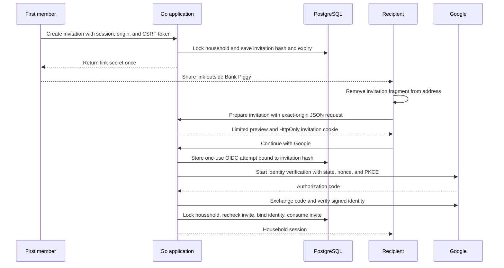
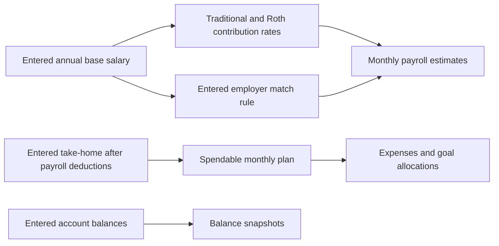
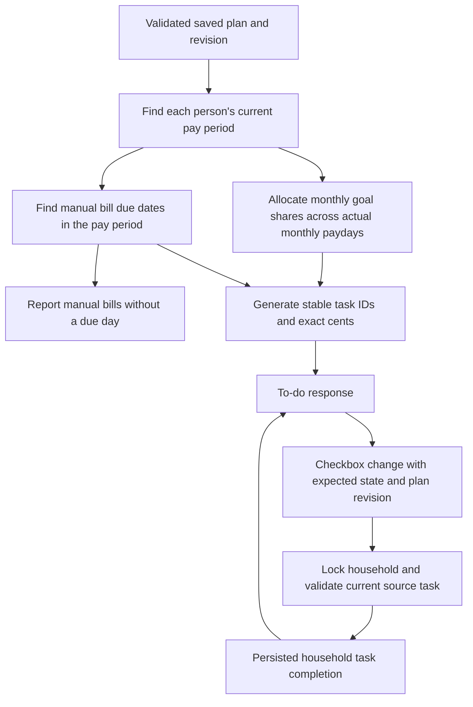

# Household sharing, payroll estimates, and pay-period tasks

This design extends the manual household plan. The implementation stays in one Go application and one PostgreSQL database. It supports one private household with at most two people. It does not add public account creation or unrelated household administration.

Reviewed reference screens: [desktop To-do](images/todo.jpg) and [mobile To-do](images/mobile-todo.jpg). The amounts and accounts are local test inputs.

## Household invitations

The first member can create a link for the second member. The link grants access to the complete household plan after Google verifies the recipient's identity. The interface states this before the link is copied. Creating a new link replaces the previous pending link. The first member can revoke it.

An invitation uses a cryptographically random 32-byte secret. PostgreSQL stores its SHA-256 hash. The raw secret appears only in the returned link and the recipient's transient entry flow. It is not stored in local storage, financial records, logs, or documentation screenshots. A link expires after seven days. Preparing a link does not consume it or grant access.

The URL uses `/join#invite=...`. A fragment is not part of the HTTP request. The entry script removes it before the application and external font resources load. The prepare request requires the configured origin and JSON content type. Its short-lived cookie is HttpOnly and binds the invitation to the later sign-in attempt. The callback uses the attempt's saved hash. It does not accept a client-selected household or member ID.

The callback must validate both the Google subject and verified email. The household row lock makes claim, profile creation, identity binding, and invitation consumption one transaction. If the second profile already exists, the claim preserves its financial fields. Otherwise, the claim appends an empty second profile and advances the plan revision. A draft opened before that addition receives a conflict instead of overwriting the new person.

An existing owner cannot claim the second slot. A consumed, replaced, revoked, expired, or already-linked invitation cannot be reused. Two simultaneous claims have one winner. Failed identity binding rolls back the claim. Later sign-ins use the pinned identity. Accepted link identities do not require an email address in the deployment allowlist; bootstrap identities retain their configuration checks.

The current deployment still serves one fixed household per mode. Demo mode remains loopback-only and cannot provide a usable private Google invitation. A future multi-household product would need explicit household creation, identity uniqueness across households, roles, removal, and account recovery. Those features are outside this change.

### Failure boundaries

| Trigger                                                            | Result                                                         |
| ------------------------------------------------------------------ | -------------------------------------------------------------- |
| Missing session, wrong origin, or invalid CSRF token on management | Reject before creating or revoking access.                     |
| Second slot already linked                                         | Reject a new invitation.                                       |
| Invalid or expired link                                            | Show a safe error without household finances.                  |
| Expired sign-in attempt                                            | Require a new Google sign-in attempt.                          |
| Invite revoked during sign-in                                      | Reject at the claim transaction.                               |
| Concurrent claims                                                  | Consume the link once under the household lock.                |
| Profile added during another edit                                  | Reject the older plan revision and preserve the browser draft. |
| Invite creation fails after setup is saved                         | Keep the saved plan; retry only invitation creation.           |

The token design follows the same secret-handling principles as OWASP's [URL token guidance](https://cheatsheetseries.owasp.org/cheatsheets/Forgot_Password_Cheat_Sheet.html): sufficient randomness, protected storage, one-use consumption, expiry, and protection against referrer leakage. An invitation grants household access, so its interface must explain that possession of the link is enough to join.

## Payroll contributions

Monthly take-home means cash received after taxes, retirement deductions, and other automatic payroll investments. Entered take-home remains the source of the spendable budget. Payroll estimates appear separately and do not reduce it again.

The employee enters separate Traditional 401(k) and Roth 401(k) percentages. Percentages use integer basis points: 100 basis points equals 1%. Their sum cannot exceed 100% of entered salary. Amounts use integer cents. Round the combined monthly employee estimate once, then assign the rounded Traditional share and the remaining cents to Roth. This keeps the displayed employee components equal to their combined estimate. Intermediate ratio arithmetic must not overflow at the accepted money bounds.

Employer matching has three modes:

- No recorded match.
- Up to five ordered tiers. Each tier defines a cumulative employee contribution threshold and the employer's match rate on that slice.
- An entered monthly employer amount for a plan that does not fit the tier model.

For example, 100% on the first 3% and 50% from 3% through 5% gives a 4% salary match when the employee contributes at least 5%. A fixed monthly entry supports unusual rules without guessing their meaning. The app does not infer vesting, eligible compensation, true-up payments, contribution eligibility, or actual deposits. Displayed figures are estimates from the supplied rule.

## Roth IRA goals

A Roth IRA goal uses the existing ordinary savings target, a personal owner, and a contribution year. The user enters the allowed annual target and the amount contributed so far. It cannot also be a trip or purchase goal. The chosen monthly contribution remains the cash allocation.

The app does not infer an allowed maximum from salary alone. The IRS defines contribution limits and income eligibility separately; other IRA contributions can also affect the available amount. See the [IRS contribution and eligibility rules](https://www.irs.gov/newsroom/401k-limit-increases-to-24500-for-2026-ira-limit-increases-to-7500). A year label prevents a prior year's target from generating current-year reminders.

## Expected pay dates

An entered actual payday anchors the schedule. Weekly and biweekly schedules advance by seven or fourteen calendar days. Monthly schedules keep the anchor's day and clamp to a shorter month's final day. An explicit month-end option keeps the final day of every month; this distinguishes February 28 followed by March 31 from a schedule on the 28th. Semimonthly schedules use two explicit days, in order. Days that would collapse onto the same date in February are invalid.

The schedule operates on date-only values, not time-of-day durations. Daylight saving changes do not move a payday. There is no current pay period before the first anchor date. Irregular pay has no inferred schedule. The supported date range is 2000 through 2100.

Expected dates do not account for bank holidays, weekends, or an employer changing its pay schedule. The user can update the anchor and cadence. The selected date identifies the current pay period: the latest scheduled payday on or before that date, through the day before the next expected payday.

## Pay-period To-do

To-do uses its own As-of date and the household or personal scope. It does not use the dashboard's monthly/yearly multiplier. Each person can have a different cadence. The server generates tasks from the saved plan and schedule, then applies persisted completion states.

Goal reminders divide the selected month's personal contribution across the actual scheduled paydays in that month. Reconciled remainder cents keep the monthly total exact. Three-payday months have smaller per-payday allocations than two-payday months. A goal task is due before the next payday. An annual IRA goal generates tasks only in its contribution year. Its current reminder is capped at the entered remaining annual target and stops when that target is funded. The cash allocation remains the user's chosen monthly amount.

Subscriptions default to automatic payment and do not create payment tasks. Other costs default to manual payment. A manual bill needs an explicit due day. Short months clamp that day to month end. Active manual bills without a due day appear in a visible setup notice instead of receiving a guessed date.

A bill task belongs to the pay period that contains its due date. It appears once per due month. A recorded payer receives the full payment reminder; ownership still controls budget allocation. Without a recorded payer, each person receives their allocated share, labeled as a share. Task IDs include the source, member, and relevant date, so two due months within one long pay period remain distinct.

Checking a task records an acknowledgment. It does not execute a payment, move money, increase an account balance, or update saved goal progress. Completion is shared by household members. The completion key includes the household, task member, and generated task ID.

Checkbox writes compare the saved plan revision and expected completion state under the household lock. They also recheck that the task still exists in the current source plan. A completion stores a signature of the task's identity, amount, and dates. A changed obligation appears incomplete; an unrelated plan edit or a name change keeps its completion. A stale checkbox cannot silently acknowledge a changed or removed obligation. Completing a task does not advance the plan revision. The frontend serializes changes, rejects stale responses, and shows failures without replacing newer user choices.

The As-of date can reopen a prior period. Completed states remain available for those generated tasks. This view is a reminder schedule from the current plan, not an immutable payment history. Editing a source amount or schedule can change historical projections. Unfinished older tasks are not automatically carried into the current period.

## Verification boundary

The release gate must include contract drift, formatting, source limits, strict lint, types, unused code, Node regressions, Go race tests with real PostgreSQL, and both builds. Invitation tests must prove expiry, replacement, revocation, identity pinning, concurrent one-use claims, and authorization boundaries. Finance tests must prove date boundaries, split reconciliation, automatic-payment exclusion, salary and match arithmetic, and unchanged spendable totals.

Browser review covers empty and populated views, mobile sizes, keyboard focus, copy failure, stale data, and failed requests. A local signed identity provider is a simulation. It does not establish live Google sign-in or deployed invitation delivery. Application changes remain local until a separate release is performed.

### Local results on 2026-11-11

- The root quality gate passed with 74 Node tests, no skipped Node tests, Go race tests against PostgreSQL 18, both builds, and the required formatting, lint, type, source-size, unused, contract, and provider checks. Dependency audits found no vulnerabilities.
- Independent review findings were fixed and reviewed again: normal sign-in recovery after an invalid invitation, payer-based setup guidance, and action-preserving revocation retry.
- The built frontend ran against the real Go API and an isolated PostgreSQL schema. A local signed provider simulated Google, including nonce, issuer, audience, signature, and PKCE checks.
- Browser checks covered automatic invitation creation after setup, copy feedback, failed revocation and retry, verified acceptance, later sign-in, preserved profiles, shared completions, missing due days, automatic-charge exclusion, changed obligations, failed checkbox writes, and a controlled two-tab conflict.
- Keyboard Space saved a task and retained focus. Changing pay periods created unchecked tasks; returning to the earlier period restored its completion. A date before the schedule anchor showed a useful empty state.
- All six views kept document bounds equal to the viewport at 390×844 and 844×390. The To-do also passed at 320×568. At a glance fit without internal scrolling at 1366×768. These are browser viewport checks, not physical iPhone tests.

Invitation secrets were omitted from screenshots and logs. No production records, deployment credentials, or real Google accounts were used. Live invitation acceptance remains a release check.
